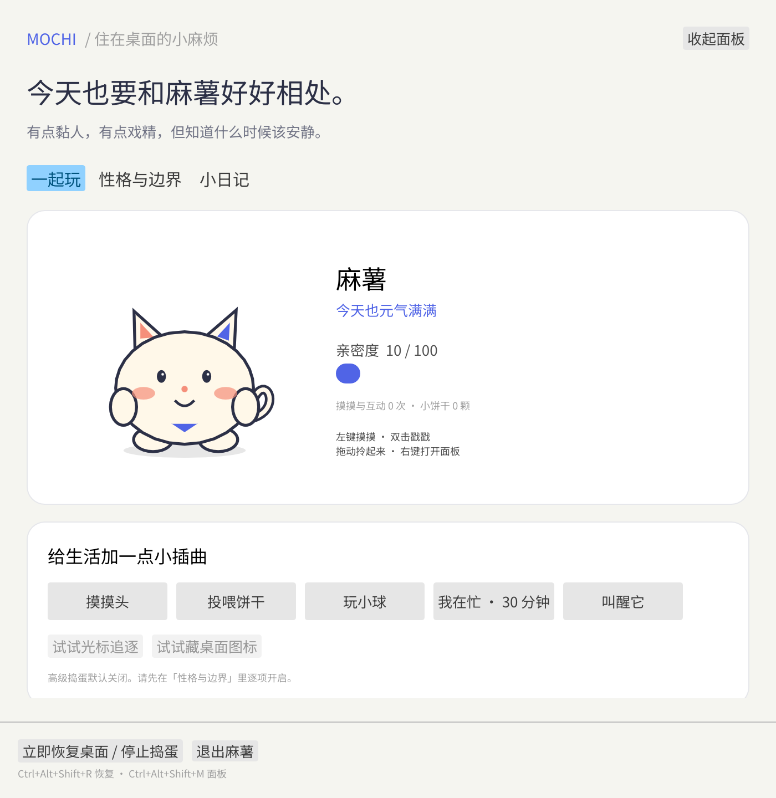

# 麻薯 Mochi

**住在桌面的小麻烦。** 一只会撒娇、装死、争宠，也知道什么时候该安静的原生桌宠。支持 Windows 和 macOS，无 Electron、无浏览器内核、无账号、无云服务。



## 它会做什么

- 左键摸头、双击戳脸、拖动拎起来；连续戳会生气，落地后假装没事。
- 投喂、玩球、打盹、散步、追逐光标、随机戏精台词和短剧情。
- 亲密度、投喂次数、互动次数本地保存；本次会话的小日记保留最近 30 条。
- 冷落一段时间后逐步争宠：提醒 → 撒娇 / 追光标 → 经授权的图标捉迷藏。
- 乖巧 / 调皮 / 小恶魔三档；安静模式、30 分钟忙碌模式、归窝、大小、节能和活动范围控制。
- 托盘 / macOS 菜单栏入口；透明区域穿透点击；追光标只做视觉遮挡，不控制鼠标、不拦截点击。
- **经单独授权**可临时隐藏真实桌面图标，5–30 秒自动恢复；有独立恢复守护进程、恢复快捷键、启动恢复和命令行恢复。

## 安装与运行

在 GitHub Actions 的 `Native builds and tests` 工作流下载对应平台的 ZIP，或从版本发布页下载打包产物。

| 平台 | 安装包 | 运行方式 |
| --- | --- | --- |
| Windows 10 / 11 x64 | `Mochi-…-x86_64-pc-windows-msvc.zip` | 解压后运行 `Mochi.exe` |
| macOS 12+ Apple Silicon | `Mochi-…-aarch64-apple-darwin.zip` | 将 `Mochi.app` 拖入 Applications |
| macOS 12+ Intel | `Mochi-…-x86_64-apple-darwin.zip` | 将 `Mochi.app` 拖入 Applications |

当前 macOS 安装包采用本地 ad-hoc 签名，并未做 Apple 公证；Windows 尚未购买代码签名证书。系统可能提示未知开发者。仅在确认来源可信后按系统流程允许启动，不需要关闭系统安全保护。

首次启动会打开控制面板。之后右键宠物、点击托盘菜单或按 `Ctrl+Alt+Shift+M` 打开面板（macOS 的 Alt 为 Option）。

| 操作 | 快捷键 / 入口 |
| --- | --- |
| 停止捣蛋、立即恢复图标并安静 30 分钟 | `Ctrl+Alt+Shift+R` / 托盘恢复菜单 / 面板恢复按钮 |
| 控制面板 | `Ctrl+Alt+Shift+M` / 右键宠物 |
| 退出 | 托盘 → 退出（会先尝试恢复桌面） |

**高级捣蛋默认关闭。**「小恶魔」等级不会自动代替授权。「我在忙」和安静模式都不会继续升级捣蛋。

### macOS 图标隐藏的特殊影响

macOS 没有在本项目中使用稳定公开的“隐藏桌面图标”窗口 API。该功能使用 `defaults` 暂时设置 Finder 的 `CreateDesktop`，并重启 Finder 生效，恢复时也需重启。Finder 窗口可能闪烁，正在执行的 Finder 操作可能受影响。应用会在独立确认框说明影响；不接受就不要开启。已有的隐藏设置不会被覆盖。详见 [恢复说明](docs/RECOVERY.md)。

## 开发

安装 Rust stable 和平台工具链：Windows 需要 Visual Studio C++ Build Tools；macOS 需要 Xcode Command Line Tools。

```sh
git clone https://github.com/JarhsonNing/desktop-pet.git
cd desktop-pet
cargo run -- --settings
cargo test --locked
cargo clippy --locked --all-targets -- -D warnings
cargo fmt --all -- --check
cargo build --locked --release
```

正常构建不需要 Node.js、Python 或下载字体，中文字体子集已内嵌。Python 3.11+ 仅用于打包或重新生成字体；重新生成字体需安装 `fonttools` 和 `brotli`。

```sh
cargo run -- --simulate
cargo run -- --data-dir /tmp/mochi-test --settings --exit-after 10 --screenshot /tmp/mochi-panel.png
python3 scripts/package.py --target aarch64-apple-darwin
sh scripts/profile_macos.sh target/release/desktop-pet idle
sh scripts/profile_macos.sh target/release/desktop-pet quiet
```

`--data-dir` 用于隔离测试数据；默认配置不受影响。测试和行为模拟不会隐藏真实桌面图标。

## 资源策略

Rust + egui/eframe + Glow 原生渲染；关闭 vsync 和持续渲染，按事件与状态唤醒：待机 2 FPS、安静 1 FPS、活跃 12 FPS，节能模式活跃 4 FPS。没有联网、后台 AI、后台截图、视频解码或整套 WebView。中文字体仅包含界面需要的字符，昵称中未内嵌的字符可能显示为缺字。

CPU 和内存是**实测结果，不作无依据的保证**。性能目标、测量方法和平台差异见 [性能说明](docs/PERFORMANCE.md)。

## 项目结构

```text
src/engine.rs       确定性情绪、互动、冷落升级与事件限频
src/app.rs          透明宠物窗口、独立设置窗口、恢复工作线程
src/art.rs          原生矢量角色，表情和弹性动作
src/shell.rs        托盘 / 菜单栏与全局快捷键
src/platform/      Windows / macOS 光标与桌面适配
src/safety.rs       恢复日志、单实例锁、独立恢复守护进程
src/config.rs       本地配置、输入校验、原子写入
scripts/            打包、字体子集、性能测量
```

技术决策见 [架构说明](docs/ARCHITECTURE.md)，验收步骤见 [测试清单](docs/TESTING.md)。

## 边界

不删除 / 移动文件，不锁鼠标，不强制完成小游戏，不安装开机自启，不读取屏幕内容，不申请辅助功能 / 屏幕录制权限。完全退出后只在存在恢复租约时短暂保留恢复守护进程。强杀所有相关进程、Explorer / Finder 故障或系统权限变化可能阻止即时恢复，此时保留恢复日志，并提供重启和手动恢复入口。

## 许可

项目代码采用 MIT。内嵌字体 `Mochi Sans` 为 Noto Sans SC 的改名子集，采用 SIL Open Font License 1.1，见 `assets/FONT-LICENSE.txt`。依赖使用各自许可。

