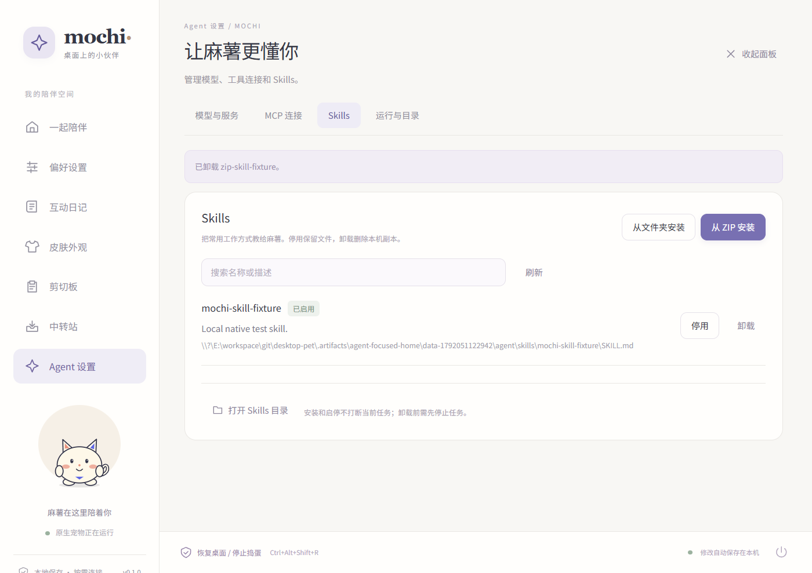
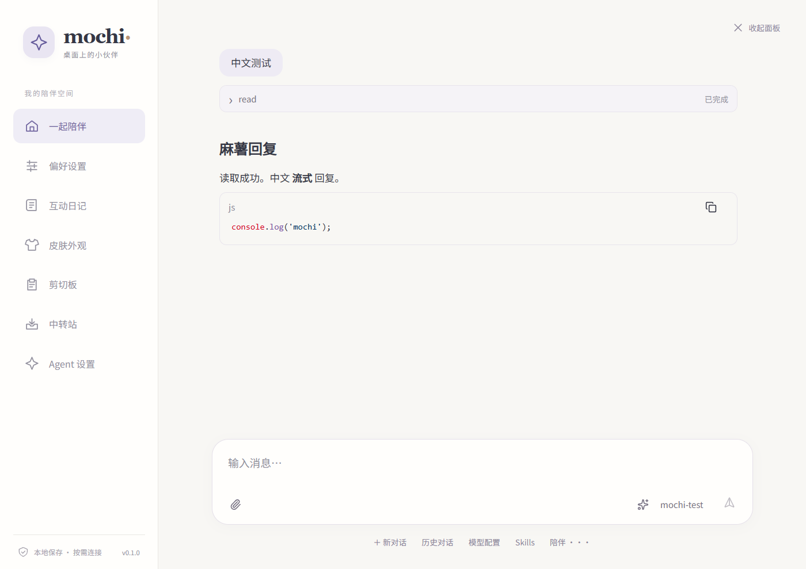
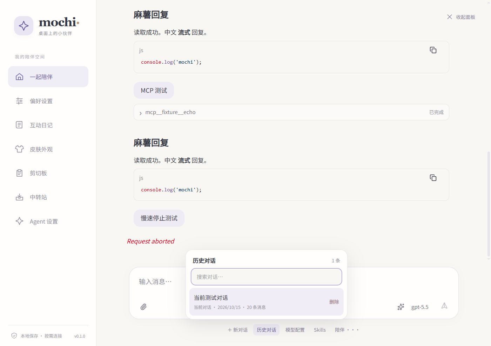

# Pi 对话

首页聊天组件在 `panel/src/agent/ui/` 内维护，复用 Pi web UI 0.75.3 源码，不再引用 `@earendil-works/pi-web-ui` 包。模型与工具执行由随麻薯分发的 Pi **1.2.0** 完成；不查找 PATH、不使用用户安装的 Pi、不提供程序路径覆盖或自更新入口。

首页直接显示输入框，首次发送消息或选择模型时才启动 Pi。空白对话将输入框居中，有消息后输入框位于底部。新建、历史对话、模型配置、Skills 和陪伴操作集中在输入区附近；高级宠物互动仍受原有授权限制。支持文本、PNG/JPEG/GIF/WebP 图片、Markdown、代码块、流式回复、工具进度及停止。浏览器内 Agent、文档解析、JavaScript REPL 与 Artifacts 执行没有启用。

“历史对话”可搜索、切换和逐条删除，显示当前会话、日期和消息数量。删除前需确认；删除当前会话会关闭空闲 Pi、删除 JSONL 并清理恢复标识，回到空白输入页。任务执行或等待交互时不能切换或删除。工具调用默认折叠为名称与执行状态，点击或用键盘展开参数和结果；失败和中止状态在折叠时仍可见，长输出在展开区内滚动。

Bash 详情分别展示实际命令和文本输出，支持中文、多行、执行中的部分输出和失败结果；无输出或缺失命令参数有明确提示。渲染使用已注册的代码块组件，不依赖未实现的 `console-block`。Windows 展示回归脚本为 `node panel/tests/agent-tools.mjs`，使用真实 WebView2 和模拟 RPC 消息覆盖渲染，不执行命令或调用模型。

侧栏的 **Agent 设置** 提供模型与服务、MCP 连接、Skills、运行与目录四个页签。模型服务可填写接口地址、协议、API Key 和模型 ID；密钥只写入本机专用配置，不回显。MCP 支持 stdio/HTTP 表单，也保留 JSON 编辑；两种视图共享数据，未在表单显示的高级字段会保留。编辑无效 JSON 时不会切回表单或覆盖已保存配置。

Skills 支持从本地文件夹或 ZIP 安装，每次导入一个包含 `SKILL.md` 的主 Skill，允许其目录内包含带有各自 `SKILL.md` 的子 Skill；子 Skill 和资源按原结构一并复制，随主 Skill 启停和卸载。ZIP 可额外包裹一层或多层目录，多个并列主 Skill 需分别导入。停用保留文件，启用状态持久保存，Pi 仅通过显式 `--skill` 加载启用项。卸载删除麻薯副本并保留原始安装来源，执行中或等待交互时需先停止任务。安装会校验 YAML 元数据、重复名称、路径、符号链接和大小限制，不运行安装脚本。未启用在线安装。

麻薯数据目录中的 `agent/` 包含：

| 目录/文件 | 用途 |
|---|---|
| `config/auth.json` | Pi API Key，不通过普通快照回显 |
| `config/models.json`、`settings.json` | Pi 兼容端点及默认模型 |
| `config/mcp.json` | Pi 原生 MCP 配置 |
| `config/web-ui.json` | 设置组件的展示配置，不保存会话历史 |
| `config/skills.json` | Skill 停用列表，重启后保留 |
| `skills/` | 唯一自动启用的 Skills 来源 |
| `workspace/` | Agent 默认工作目录 |
| `sessions/` | Pi JSONL 会话历史的唯一来源 |
| `current.json` | 当前会话文件标识 |

在 Agent 设置的“运行与目录”中打开这些目录。执行中保存的配置及 Skill 启停更改在任务及输入交互结束后应用；切换会话需要先停止当前任务。订阅 OAuth 登录不在首版范围内。MCP 服务自身要求的程序需按其配置准备。

关闭面板不会停止任务；再次打开恢复 Pi 的权威状态与历史。进程异常时保留已有历史，不自动重发结果不明的请求。面板关闭、没有任务或待回答交互时，Pi 空闲 60 秒后退出。退出麻薯会终止 Pi 及其 MCP 子进程。

## 开发与分发

先构建前端，再构建 Rust 工作区：

```powershell
npm --prefix panel ci
npm --prefix panel run build
cargo build --locked --release --workspace
python scripts/prepare_pi.py --target x86_64-pc-windows-msvc --destination target/release/runtime/pi
```

调试构建将目的目录改为 `target/debug/runtime/pi`。目标平台资产及 SHA-256 固定在 `scripts/pi-runtime.json`。下载只发生在开发准备与打包阶段；打包保留完整运行时目录、许可证和资源，用户运行 Pi 无需安装 Node.js。

组件及原有兼容修改直接保存在 `panel/src/agent/ui/`，不再使用安装补丁。聊天布局位于 `components/AgentInterface.ts`，输入框位于 `MessageEditor.ts`；首页融合样式位于 `panel/src/agent/page.css`，设置表单与技能管理位于 `panel/src/AgentPreferences.vue`。源码来源与许可见该目录的 README 和 LICENSE，打包时一并收录。Lit/mini-lit 等基础依赖继续用于控件、Markdown 和代码高亮；Vite 在本地生成 Tailwind CSS，并将纯模型元数据与模型 SDK 入口隔离。聊天 iframe 不建立 Tauri 全局入口；所有操作通过校验来源、命令及参数的父页面消息桥。

```powershell
cargo fmt --all -- --check
cargo clippy --locked --workspace --all-targets -- -D warnings
cargo test --locked --workspace
node panel/tests/agent-native.mjs
```

原生验收使用独立数据目录、真实 WebView2 和包内 Pi，模型由本地模拟服务提供，不使用付费 API。结果及截图保存在 `.artifacts/agent-e2e/`。没有完成实机验收的平台不能仅凭打包成功视为已验证。

运行原生 MCP 生命周期验收前，先执行 `cargo build --locked --release --example agent_mcp_fixture`。测试驱动本身使用 Node.js；被测麻薯、Pi 与原生 MCP 服务的 PATH 仅保留 Windows 系统目录。该检查验证不依赖 Node.js，不能替代全新 Windows 虚拟机验收。

## Windows 验证记录（2026-10-15）

本次改动通过 TypeScript/Vite 构建、Rust 格式检查、Clippy 和 95 项工作区发布模式测试。13 项真实聊天/设置/生命周期检查曾完整通过，覆盖工具默认折叠、键盘展开、失败/中止、进度更新保留展开状态，以及历史搜索、取消删除、删除其他会话、删除当前会话后重开不恢复。最终构建单独通过 5 项历史管理验收，包含确认框居中、JSONL/恢复标识清理和重开后输入可用，记录位于 `.artifacts/chat-history-final/report.json`。但最新完整生命周期复测在关闭面板的空闲等待阶段遇到“Agent 服务已停止”，该轮未全部通过，原因未确认，失败记录保留在 `.artifacts/agent-history-review/report.json`。此前 14 项其他页面回归通过。详情见 [agent-home-windows-verification.json](agent-home-windows-verification.json)。聊天脚本约 783 kB（gzip 约 170 kB），仍保留超过 500 kB 的构建体积提示。此轮没有重新打包 ZIP，也没有重新验证 macOS。

Skills 的原生文件选择接口已构建，自动窗口测试以固定选择路径替代系统文件对话框；实际文件复制、ZIP 解包、配置保存和 Pi 加载均走真实宿主。系统文件选择交互及真实输入法候选窗口仍需人工验收。

此前仅将 UI 改为项目内源码时，清洁安装、TypeScript/Vite 构建、流式重建测试及 10 项真实 Windows 面板/生命周期检查通过；结果位于 `.artifacts/agent-local-ui/report.json`。

Windows x64 预览包通过 10 项聊天/生命周期检查及 14 项面板回归。真实包内 Pi 对本地模拟服务发起 9 次模型请求，完成 4 次工具结果，包含原生 MCP 服务；页面没有 JavaScript 异常，退出后 MCP 服务及其后代均已回收。完整记录见 [pi-windows-verification.json](pi-windows-verification.json)。

单次打包产物采样：Pi 首次对话启动约 4.1 秒（含资源校验及 MCP 启动），ZIP 约 67 MiB，解包后的 Pi 资源约 113 MiB。以下为同一次进程使用 AI 前后的工作集，不是与旧版本的性能对照：

| 场景 | 宠物主进程 | Pi |
|---|---:|---:|
| 使用 AI 前 | 97.0 MiB | 0 |
| 使用 AI 后空闲 | 108.2 MiB | 153.4 MiB |
| 关闭面板并回收 Pi 后 | 113.4 MiB | 0 |

系统真实输入法候选窗口、全新 Windows 虚拟机和 macOS GUI 尚未人工验收；中文组合输入通过自动事件测试。工作集受分配器缓存影响，不能用一次采样推断长期内存增长。







