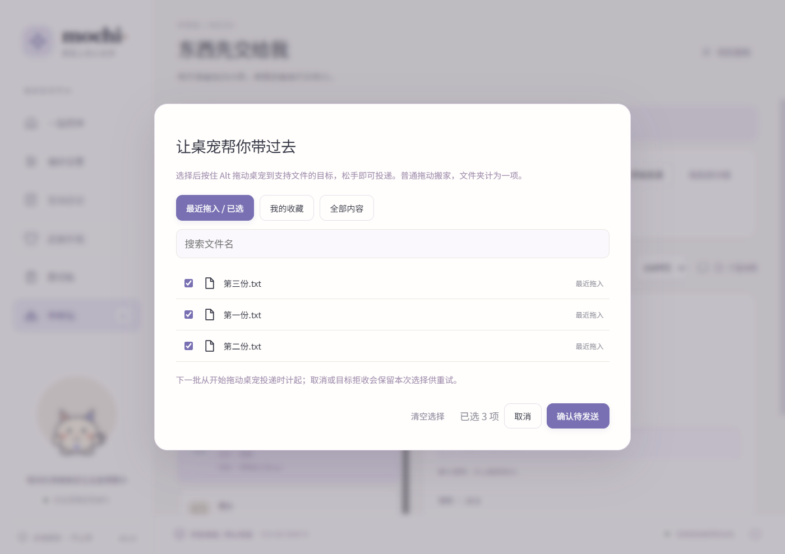

# 桌宠投递与此电脑文件箱

## 选择文件后拖动桌宠

1. 把文件拖到桌宠或面板的中转站。每次拖入保存为独立记录，其中每个文件分别进入待发送选择。连续拖入多批会累加，文件夹算一项。
2. 右键桌宠、点击右下角数字，或打开「中转站 → 选择待发送文件」，检查勾选。支持最近拖入／已选、我的收藏、全部内容和文件名搜索，同一记录里的文件可以分别选择。文字和图片也能选，分别提供 `.txt` 和 `.png`。
3. 确认后等待文件准备完成，按住 **Alt + 鼠标左键** 拖动桌宠到目标应用，松开即以系统原生 **复制** 拖放提交所选内容。目标应用必须支持对应内容的拖入；普通文本框不一定接收文件。

**普通拖动始终用于搬家，Alt + 拖动用于文件投递**；没有选择时，Alt + 拖动会打开待发送选择器。数字角标显示已选文件／内容数量，没有选择就隐藏。面板本身的记录选择与这里的待发送选择互相独立。右键桌宠时，已打开的面板会恢复显示并前置聚焦，包括面板已最小化或仍停在中转站的情况。

“最近拖入”的批次边界是**开始一次桌宠投递**：此前每次拖入的所有文件都默认选中。开始投递后再拖入的内容属于下一批。复制任务按收到拖入时的批次归属；上批大文件稍后保存完成，也不会混入下一批。点「添加文件」、粘贴或从剪切板收纳仍保存中转记录，需手动选为待发送。

成功交付目标后移除本次待发送选择，保留中转记录；下一批新选择保留。取消或目标拒收时保留本次选择以便重试。下一批边界已经推进，不会因取消重新选中之前手动取消的文件。选择和批次保存到本地，重启仍可继续。

导出复制、原生拖放及文件准备在宠物进程中执行；关闭 Tauri 面板不影响待发送选择。空闲时不为此功能保留 WebView 或运行文件扫描循环。



## Windows「此电脑 → Mochi 文件箱」

在「偏好 → 此电脑 · Mochi 文件箱」开启 **在此电脑显示文件箱**。默认关闭。开启后生成展示副本，并为当前 Windows 用户注册入口，无需管理员权限。资源管理器已有窗口可能需要刷新。

| 分类 | 展示内容 |
| --- | --- |
| 中转站 | 中转站的记录，每条记录一个文件夹，保留内部目录层级 |
| 我的收藏 | 已收藏的剪切板及中转记录；两边同时出现时分别生成副本 |

文件是真实路径，可以从资源管理器浏览、复制、拖出，在支持该入口的系统文件选择窗口选取。文本导出为 UTF-8 `.txt`，图片为 `.png`；收藏的剪切板文件若原件已失效，会展示失效说明。宠物退出后仍能浏览已经生成的副本，重新运行后继续更新。

首版仅提供内容展示和取用：向目录拖入、改名、编辑或删除不会写回中转站或收藏。新增文件请继续拖到桌宠或面板。

后台在内容新增、收藏变化或删除后更新展示；点击「刷新展示副本」可重新生成。原文件和内容库不受副本编辑影响。刷新需要替换或清理已被用户修改的生成目录时，会把旧目录放进文件箱下的 **本地改动保留**；根目录自行新增的文件不自动删除或导入。停用只移除系统入口，保留已导出的内容。

展示副本另外占用磁盘，单独以「内容库空间上限」作为限额，界面另列用量。更新时需为新副本保留临时空间；额度不足时提示错误，保留原内容及已完成展示，不自动删除收藏或中转记录。`本地改动保留` 也计入用量，确认不需要后可自行清理。异常退出留下的 `.prepare-…` 目录会阻止覆盖并提示检查；确认其中没有需要保留的文件后可手动清理，再刷新。

## 自定义存储目录

在「偏好设置」中可以分别选择：

- **中转站存储目录 → 更换目录**：选择一个空文件夹，将现有内容库复制过去。剪切板历史、中转内容和收藏共用这份数据库及资源，因此会一起迁移。
- **此电脑 · Mochi 文件箱 → 更换文件箱目录**：独立选择一个空文件夹，复制当前展示副本及目录内的本地改动；已开启的「此电脑」入口会更新到新位置。未开启入口时也可以先选择位置。

切换在后台执行，提供已复制大小和取消入口；成功后立即生效，无需重启。重启会继续使用自选目录，后续收纳、附件落地、预览和导出均使用新的内容库。正在拖出文件时请先完成拖放，再更换目录。

迁移使用 SQLite 一致性快照与临时目录提交，不覆盖目标中的已有内容。新旧目录、内容库与文件箱不能互相嵌套，也不能用磁盘根目录或应用数据目录整体作为目标。取消、无法写入或空间不足时继续使用原目录；原有内容不会删除。切换成功后旧目录作为副本保留，额外占用磁盘空间；建议退出应用并确认不再需要旧内容后再自行清理。

文件箱迁移在中断后会根据已提交的目录配置恢复系统入口，移除本次迁移留下的非活动入口。内容库磁盘离线时会明确报错，不会悄悄创建空库替代已有历史。

旧目录是迁移时的备份，后续新增和删除不会同步到旧备份；清空历史也不会自动清理其中保留的旧记录。

目录配置保存在应用数据目录的 `storage.json`（版本 1），与昵称等 `config.json` 设置分开。省略自选路径时沿用原来的默认位置；未知版本不会被覆盖。应用配置、皮肤设置和桌面恢复文件仍在原应用数据目录。


Windows 验证包含 91 项发布模式 Rust 测试、Clippy、格式与 Vue 构建，以及 5 项真实面板检查。原生选择窗口验证了归属面板和取消行为；迁移使用隔离路径经真实 IPC 执行，验证目录保护、切换、原副本保留及重启。详见 [存储目录验证记录](storage-windows-verification.json)。本次未运行 macOS 检查。

## 兼容与后续升级

```text
delivery-state.json               version=1，批次与逐文件选择
storage.json                      version=1，用户选择的两个存储目录
Mochi 文件箱/
  .mochi-view.json                 version=1，记录 ID → 展示目录、内容签名
  中转站/<标题>-<记录标识>/...
  我的收藏/<标题>-<记录标识>/...
  本地改动保留/...                 仅在需保留用户改动时创建
```

原有 `content/index.sqlite` 仍是唯一内容库，本次未增加数据库或更改其 schema。待发送引用使用 `{entry, item, file}`，能定位记录内的某个文件。展示模块只接收快照和文件来源，Windows 注册模块只负责入口；以后可在同一记录 ID 上增加原生接收和显式写回服务。索引或投递状态版本未知时拒绝覆盖，留给升级版本处理。

入口 CLSID 按数据目录生成，各隔离测试目录不会占用正式入口。只注册当前用户的本项目 CLSID 和 MyComputer NameSpace 项；停用时仅移除这两项。实现使用 [Microsoft 的 Shell 命名空间位置机制](https://learn.microsoft.com/en-us/windows/win32/shell/nse-junction)及[文件夹实例注册方式](https://learn.microsoft.com/en-us/windows/win32/shell/integrate-cloud-storage)；这里仅复用本地文件夹展示，不注册云同步提供程序。

## 验证

2026-10-15 Windows 验证：74 项发布模式 Rust 测试、工作区 Clippy、格式检查、Vue/TypeScript 构建及 13 项真实 Tauri/WebView2 检查通过，摘要见 [验证记录](filebox-windows-verification.json)。

手势修订为普通拖动搬家、Alt + 拖动投递后，74 项 Rust 测试及 14 项真实面板检查通过。新增检查把已在中转站的面板最小化，再走与右键桌宠共用的唤起路径，验证同一窗口恢复、可见且成为 Windows 前台窗口。开发测试使用独立 WebView2 配置目录及可配置的 `MOCHI_TEST_PORT`，避免与其他运行中的面板共用调试会话。

`tests/delivery.rs` 覆盖多批累加、逐文件选择、开始时切批、晚完成任务、成功与取消、重启及删除失效引用。`tests/explorer.rs` 覆盖真实文件副本、文字／图片、失效原路径、收藏、刷新保留本地改动、目录越界、版本保护、空间不足、取消、选择单个文件及混合内容同名导出；Windows 测试实际注册独立入口，通过 Shell COM 枚举此电脑并读取子目录，最后移除测试入口。

真实 Tauri / WebView2 自动化见 `panel/tests/native.mjs`，使用隔离内容库。它覆盖多批导入、原件删除后导出、逐文件选择、收藏、清空、原生窗口取消过期拖动、文件箱开关与不写回。它没有替代邮件、浏览器上传、聊天应用等接收端的跨应用兼容性验收。macOS 本次按用户要求未运行检查；「此电脑」入口仅 Windows 提供。
