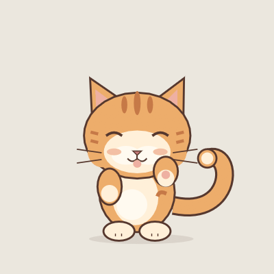

# 用技能创建自己的皮肤

`skills/mochi-skin-create` 是可复用的 Codex 技能包。它把角色提示词转成可编辑的 UI 定义，并使用实际程序完成格式校验、十状态预览、动作预览和 `.mochi` 打包。

精细角色默认采用透明 PNG 动画帧：毛发、光影、表情和动作由图片表现，JSON 只保留状态与播放速度、位置和气泡等配置。矢量方式仍可用于明确要求的几何插画。图片质量取决于实际素材，导入工具不会把粗糙插画自动变成精细绘画。

技能源码在仓库中；本次创建的技能也已放入本机 `~/.codex/skills/mochi-skin-create`。其他开发者可以把该目录复制到自己的技能目录，保留其 `scripts`、`references`、`assets` 和 `agents` 子目录。

示例请求：

```text
使用 $mochi-skin-create，帮我创建自己的桌宠皮肤。
我希望生成一只可爱的小猫皮肤，动作自然灵动。
```

也可以说明颜色、性格、材质、参考图或想突出的动作。短提示词会由技能补足合理设计细节，不必先知道 JSON 格式。

## 技能包内容

| 文件 | 用途 |
| --- | --- |
| `SKILL.md` | 角色设计、状态绑定、校验、预览和交付流程 |
| `references/format.md` | UI 字段、完整节点替换、资源与恢复按钮约束 |
| `references/motion.md` | 呼吸、尾巴、耳朵、步态、相位和循环设计 |
| `assets/base-ui.json` | 可校验的结构起点，角色占位体需要重新设计 |
| `scripts/skin_tool.py` | 初始化、程序校验、动画边界采样、原生预览和打包 |
| `scripts/import_png.py` | 导入透明 PNG 帧目录或精灵图，自动生成状态绑定 |
| `references/png-animation.md` | 素材一致性、透明背景、循环与资源预算 |
| `agents/openai.yaml` | 技能的名称、说明和默认调用提示 |

## 手动调用工具

需要 Python 3.11+；预览 GIF 还需要 Pillow。预览例程需要当前项目的 Rust 工具链和可运行原生 GUI 的图形环境。初始化、校验和打包不依赖 Pillow；预览使用项目的真实 `SkinRenderer`，没有另一套近似绘制实现。

```powershell
python skills/mochi-skin-create/scripts/skin_tool.py init --output my-skin --id my-cat --name "My Cat"
python skills/mochi-skin-create/scripts/skin_tool.py check --project . --skin my-skin
python skills/mochi-skin-create/scripts/skin_tool.py preview --project . --skin my-skin --output my-preview --mood happy --seconds 3 --fps 12
python skills/mochi-skin-create/scripts/skin_tool.py package --project . --skin my-skin --output dist/my-cat.mochi
```

初始化后的圆形只是结构占位，接着需要编辑 `pet.json` 创建角色。检查报告中的 `bounds_warnings` 是动画采样发现的潜在裁切；曲线控制框和文字边界是保守估计，需要结合实际预览判断。

预览输出 `gallery.png`、`frames/frame-*.png`、可选的 `animation.gif` 和 `report.json`。报告记录真实校验结果、原生渲染是否通过、帧数量、不同帧数量，以及循环接缝是否需要检查。静态皮肤可以通过格式校验，但不能据此宣称它有自然动作。

原生预览工具只绘制皮肤，不运行行为引擎或桌面捣蛋。预览支持 1–30 FPS。矢量皮肤保留待机 2 FPS / 活跃 12 FPS；多帧 PNG 按当前播放速度提高重绘预算，最高 30 FPS。安静仍为 1 FPS，节能仍为 4 FPS。

皮肤包格式与加载方式见 [皮肤说明](SKINS.md)。

## 导入自己的 PNG 动画

准备透明 PNG 序列，每帧画布尺寸相同，脚底基线和角色中心保持一致，不要逐帧裁成不同大小。按状态分文件夹，文件名按数字自然排序：

```text
cat-frames/
  idle/000.png, 001.png, ...
  happy/000.png, 001.png, ...
  grumpy/...
  sleep/...
  dragged/...
  play/...
  chase/...
  hiding/...
  dizzy/...
  walk/...
```

```powershell
python skills/mochi-skin-create/scripts/import_png.py --project . --frames cat-frames --output skins/my-png-cat --id my-png-cat --name "My PNG Cat" --fps 12
python skills/mochi-skin-create/scripts/skin_tool.py preview --project . --skin skins/my-png-cat --output dist/my-cat-preview --mood happy --seconds 3 --fps 12
python skills/mochi-skin-create/scripts/skin_tool.py package --project . --skin skins/my-png-cat --output dist/my-png-cat.mochi
```

只有待机素材时可显式加 `--allow-idle-fallback`，其他状态复用待机，报告会列出复用项。默认要求十种状态齐全，避免把缺少的动作误当作制作完成。

也可以提供一张没有间距、文字或网格线的精灵图：十行依次为 `idle, happy, grumpy, sleep, dragged, play, chase, hiding, dizzy, walk`，每行相同帧数，例如六列：

```powershell
python skills/mochi-skin-create/scripts/import_png.py --project . --sheet cat-sheet.png --columns 6 --output skins/my-sheet-cat --id my-sheet-cat --name "My Sheet Cat" --fps 12
```

导入需要 Pillow；工具保留透明度和原始像素，按比例设置统一显示位置，保留气泡和恢复按钮，校验通过后才输出目录。输入文件不会被修改，已有输出不会被覆盖。不直接播放 APNG，也不自动去除背景。

总图片像素预算为 12,582,912；例如十种状态各六张 256×256 帧，或各十二张 180×180 帧，均在预算内。每种状态最多 64 帧，整个包最多 256 个条目，文件大小限制仍由打包器检查。可以在生成的 `pet.json` 调整各状态的 `fps`；普通模式会根据当前多帧 PNG 的播放速度提高重绘预算；安静和节能模式仍可能跳过短促动作。

## 小猫提示词实测

已使用「我希望生成一只可爱的小猫皮肤，动作自然灵动」完成一次独立创作测试，生成原创橘色虎斑小猫 Mikan Kitten，包含 71 个可编辑矢量图层、十种情绪状态、轻呼吸、摆尾、抬爪和交替迈步。

源码位于 [skins/mikan-kitten](../skins/mikan-kitten/pet.json)，成品包位于 `dist/skins/mikan-kitten.mochi`。可在「皮肤」页选择该包，或运行：

```powershell
cargo run -- --skin skins/mikan-kitten --settings
```



[十状态画廊](skin-previews/mikan-kitten/gallery.png) · [迈步动画](skin-previews/mikan-kitten/walk.gif)

源文件及皮肤包通过真实程序校验；十种状态的动画边界采样无警告。开心和迈步分别录制了 4 秒、12 FPS 的原生预览，各 48 帧均不同，循环接缝没有触发检查警告。实际画面检查后修正了尾巴端点和追逐姿态的耳朵对齐；隔离配置下的正常应用加载与自动退出均成功。

其他八种状态检查了静态画廊和动画边界，未分别录制完整动画。画廊只绘制角色层；恢复气泡保留了布局并通过格式校验，未执行隐藏桌面图标来测试气泡。预览截图受屏幕 DPI 影响，这次矢量小猫测试未修改基准重绘预算。

测试的可复核数据：[开心报告](skin-previews/mikan-kitten/happy-report.json)、[迈步报告](skin-previews/mikan-kitten/walk-report.json)。
