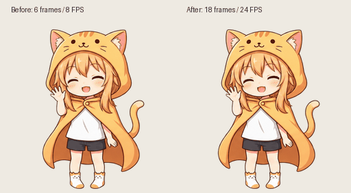

# 动画补帧版

原版每种状态六帧，播放速度为 2–12 FPS，旧应用活跃重绘上限为 12 FPS。新版本使用 [RIFE ncnn Vulkan](https://github.com/nihui/rife-ncnn-vulkan) v4.6 模型补出中间帧，保留所有原始关键帧的 RGBA 像素，保持每个动作的周期不变。

应用根据当前可见、多帧 PNG 的播放速度提高重绘预算，最高 30 FPS。静态 PNG 和矢量保留基准预算，安静仍为 1 FPS，省电仍为 4 FPS。循环内补帧不提供跨状态的姿态插值。

| 状态 | 新帧数 | 播放 FPS | 周期（秒） |
| --- | --- | --- | --- |
| idle | 18 | 6 | 3 |
| happy | 18 | 24 | 0.75 |
| grumpy | 18 | 12 | 1.5 |
| sleep | 18 | 6 | 3 |
| dragged | 18 | 18 | 1 |
| play | 18 | 18 | 1 |
| chase | 12 | 24 | 0.5 |
| hiding | 18 | 12 | 1.5 |
| dizzy | 18 | 18 | 1 |
| walk | 18 | 24 | 0.75 |

共 174 张 256×256 PNG，11,403,264 像素。为容纳更多帧，读取器的图片预算提高到 12,582,912 像素、256 个包条目；包的 16 MiB、展开 32 MiB、单文件 8 MiB 上限保留。解码图片与纹理占用增加；本机打开设置面板六秒的加载短测工作集峰值为 225.2 MiB，这不是关闭面板后的长期性能结果。

## 加载

该包需要本次更新后的程序。旧版的 4M 图片预算会拒绝补帧皮肤。

先正常退出正在运行的旧程序，然后从项目目录运行：

```powershell
cargo run --release -- --skin skins/orange-hood-girl-smooth --settings
```

或解压 `dist/Orange-Hood-Girl-Smooth-Windows.zip` 后运行 `Run-Smooth.cmd`。它包含更新后的发布版程序和 `.mochi`。原来的六帧皮肤仍保留在 `skins/orange-hood-girl`。

## 制作和验证

补帧使用便携 RIFE 工具，运行时应用只加载最终 PNG，不运行模型，也不需要安装 OpenCV、RIFE 或更换显卡驱动。模型与下载工具留在忽略目录 `.artifacts/rife`；生成脚本为 `interpolate_frames.py`，详细参数和帧数记录在 `rife-frames/interpolation-report.json`。

中间帧通过纯绿底恢复 alpha，清理了腿部和毛线球附近的绿色残留；原始关键帧直接复制，RGBA 完全一致。闹脾气动作重新排列了六张原始帧，减少直接从右侧脸跳到左侧脸的变化。插帧仍可能轻微软化局部线条，不能替代逐帧绘制精确的新姿势。

源码和 `.mochi` 校验通过；各状态原始关键帧、独立帧数量、透明度、周期一致性验证通过。十种状态各以 24 FPS 捕获三秒原生预览，循环接缝检查均未触发警告。详见 `smooth-preview-results.json` 和 `native-smooth-<state>/report.json`。GIF 使用交替的整数厘秒时长，使总时间与采样率一致。

38 项 Rust 测试、Clippy、格式检查通过；隔离配置的正常应用加载、截图和退出成功，未启用捣蛋。加载报告为 `smooth-app-report.json`。


