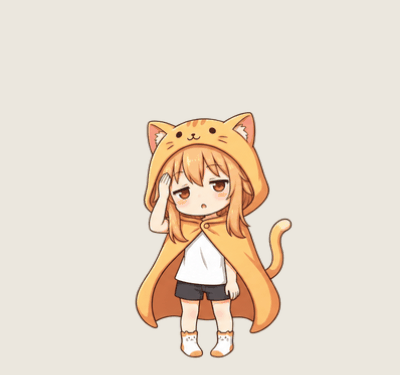

# 头晕动画手部修正

用户反馈头晕动画的手部动作错误。逐帧复核发现，旧原图中扶头动作从一侧手换到了另一侧，补间时还出现手短暂消失和手臂穿过斗篷的现象。

使用此前已授权的 `imagegen` API/CLI、`gpt-image-2` 和同一张人物三视图重新生成六张关键帧。修正版固定角色右手（画面左侧）扶额头，另一只手自然下垂，头部轻轻左右晃动。关键帧和 18 张最终帧的手部近景均已人工检查；没有再次出现换手或手消失的现象。

## 交付

- `dist/skins/orange-hood-girl-smooth-dizzy-v2.mochi`：补帧皮肤包，头晕为 18 帧 / 18 FPS，循环一秒。
- `dist/skins/orange-hood-girl-dizzy-v2.mochi`：六帧版本皮肤包，头晕为 6 帧 / 6 FPS，循环一秒。
- 现有 `skins/orange-hood-girl` 和 `skins/orange-hood-girl-smooth` 的头晕 PNG 已更新；当前包名的下载副本及 Windows 打包目录也已更新。
- 在控制面板「皮肤」页选择修正版 `.mochi`；已经使用更新过的同一路径时，点击「再次加载」。程序代码和播放参数没有改动，不需要为本次图片修正重新编译。

## 证据与验证

- `prompt.txt`：完整最终生成提示词，重点约束同一只手、手臂连续性和小幅头部运动。
- `generation.json`：真实 API/CLI 调用结果，不含请求凭据。
- `sheet.png`、`keyframes/`：生成的原始精灵图及六张透明关键帧。
- `interpolated/dizzy/`：RIFE v4.6 补出的 18 张透明帧；每第三张与修正后的关键帧 RGBA 完全一致。
- `before-contact.png`、`after-dark.png`、`hands-review.png`：逐帧对照、深底检查和手部近景。
- `before/`：原有头晕素材备份；`before-hashes.json` 记录其他九种状态的图片散列、UI 和播放配置。复核确认其他状态的素材、定义和播放时长没有变化。
- 两种源码与两种 `.mochi` 均通过原生校验，动画边界采样无警告。
- `native-preview/`：实际 `SkinRenderer` 以 24 FPS 捕获三秒，72 张截图中有 18 张不同画面；GIF 时长三秒，循环接缝没有触发检查警告。此处 24 FPS 是预览采样率，头晕动作本身仍以 18 FPS 播放。

